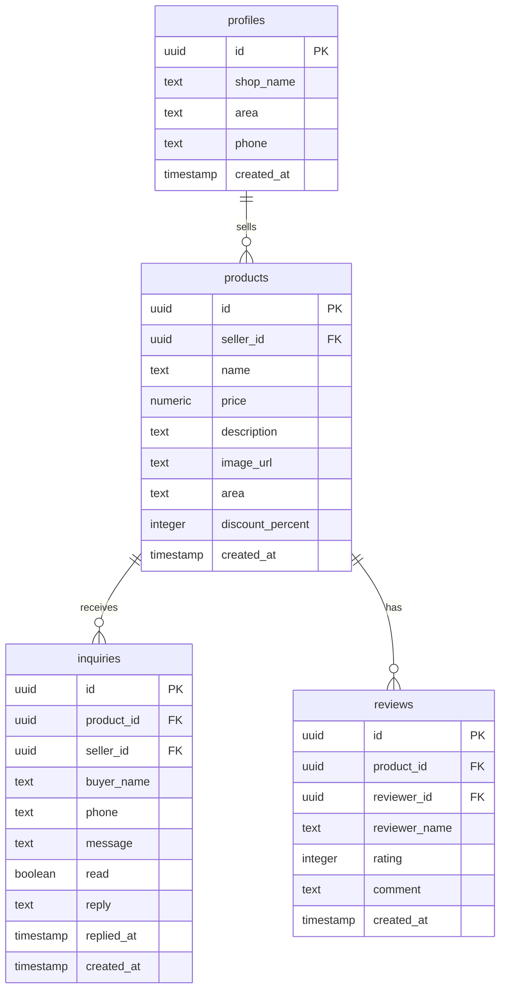

<div align="center">

# 🏪 Community Makers' Market

### Empowering Local Talent — From Skill to Income

A full-stack community entrepreneurship platform that helps **homemakers, students, artists, and self-help groups** turn their craft into a sustainable business.

[](https://react.dev)
[](https://tanstack.com/start)
[](https://supabase.com)
[](https://tailwindcss.com)
[](https://typescriptlang.org)
[](https://vite.dev)

</div>

---

## 📖 About

**Community Makers' Market** is a social-impact web platform designed for **Tier 2 & Tier 3 Indian cities and towns**. It provides aspiring micro-entrepreneurs — especially women, homemakers, and students — with everything they need to start, grow, and sell:

- 💡 **Curated business ideas** with step-by-step guides, materials lists, and pricing advice
- 🛒 **Zero-commission marketplace** to list and sell handmade products directly
- 📋 **Government schemes directory** with eligibility info and application steps
- 🌐 **Bilingual interface** — full English and Telugu (తెలుగు) support

> *"Every maker deserves a market."*

---

## ✨ Features

### 🏠 Homepage
- Hero section with impact statistics and call-to-action
- "Why this platform exists" — problems & solutions laid out side by side
- Featured success story with real community member profiles

### 💡 Business Ideas Explorer
- **24+ curated home-based business ideas** categorized by startup cost:
  - 🟢 Starter (Under ₹50)
  - 🟡 Under ₹100
  - 🔴 Under ₹200
- Each idea includes: materials, step-by-step instructions, pricing suggestions, marketing tips, and difficulty level
- Modal detail view with shop links for raw materials

### 🛒 Marketplace
- Browse handmade products from real sellers with images, pricing, discounts, and star ratings
- Product detail pages with buyer inquiry forms (name, phone, message)
- Seller shop names and area/city displayed on listings
- Demo product showcase with 18 handcrafted item categories

### 📊 Seller Dashboard
- **My Products** — Add, edit, delete products with image upload, pricing, discount %, and area
- **Inquiries** — View buyer messages, mark read/unread, manage incoming interest
- **My Profile** — Edit shop/brand name, area/city, phone number (displayed on marketplace)
- Secure email + password authentication via Supabase Auth

### 📋 Government Schemes
- Searchable directory of Indian government schemes for women entrepreneurs, SHGs, and small businesses
- Each scheme shows: benefits, eligibility, how to apply, and official links
- Real schemes: Mudra Yojana, Stand-Up India, PM Vishwakarma, and more

### 🌟 Success Stories
- Real-life stories of homemakers, students, and self-help groups who built income from their craft
- Photo cards with quotes and role descriptions

### 📞 Contact Page
- Contact form powered by Formspree
- Email, phone, and social media links (Instagram, Facebook, YouTube)

### 🌐 Bilingual Support
- Full **English** and **Telugu (తెలుగు)** translations across all pages
- Language switcher in the navbar — persists choice via localStorage
- Noto Sans Telugu font for native script rendering

### 🎨 Design System
- **Warm artisan aesthetic** — terracotta, sage, mustard, and cream color palette
- Display font: **Fraunces** (serif) · Body: **Plus Jakarta Sans**
- Rounded cards, gradient overlays, grain textures, and soft shadows
- Fully responsive — mobile-first with desktop breakpoints

---

## 🛠️ Tech Stack

| Layer | Technology |
|-------|-----------|
| **Framework** | [TanStack Start](https://tanstack.com/start) (React 19 SSR) |
| **Routing** | [TanStack Router](https://tanstack.com/router) (file-based, type-safe) |
| **Styling** | [Tailwind CSS v4](https://tailwindcss.com) + custom design tokens |
| **UI Components** | [Radix UI](https://radix-ui.com) primitives + [shadcn/ui](https://ui.shadcn.com) |
| **Database** | [Supabase](https://supabase.com) (PostgreSQL) |
| **Auth** | Supabase Auth (email/password) |
| **State** | [TanStack Query](https://tanstack.com/query) (server state) + React useState |
| **Build** | [Vite 7](https://vite.dev) + [Nitro](https://nitro.build) (SSR) |
| **Language** | TypeScript 5.8 (strict mode) |
| **Forms** | [Formspree](https://formspree.io) (contact form) |
| **Icons** | [Lucide React](https://lucide.dev) |
| **Fonts** | Google Fonts — Fraunces, Plus Jakarta Sans, Noto Sans Telugu |
| **Linting** | ESLint 9 + Prettier |
| **Package Manager** | [Bun](https://bun.sh) |

---

## 📁 Project Structure

```
community-makers-hub-80/
├── src/
│   ├── assets/              # Product & story images (26 JPGs)
│   ├── components/
│   │   ├── site/            # Navbar, Footer
│   │   └── ui/              # 40+ shadcn/ui components
│   ├── hooks/               # Custom React hooks
│   ├── integrations/
│   │   └── supabase/        # Client, server client, auth middleware, types
│   ├── lib/
│   │   ├── auth.tsx          # Auth context provider
│   │   ├── i18n.tsx          # Language provider (EN/TE)
│   │   ├── translations.ts   # 1500+ lines of bilingual content
│   │   └── utils.ts          # Utility functions
│   ├── routes/
│   │   ├── __root.tsx         # Root layout with meta tags
│   │   ├── _app.home.tsx      # Homepage
│   │   ├── _app.marketplace.tsx # Product marketplace
│   │   ├── _app.product.$id.tsx # Product detail page
│   │   ├── _app.dashboard.tsx   # Seller dashboard
│   │   ├── _app.auth.tsx        # Sign in / Sign up
│   │   ├── _app.business-ideas.tsx # Business ideas explorer
│   │   ├── _app.schemes.tsx     # Government schemes
│   │   ├── _app.success-stories.tsx # Success stories
│   │   ├── _app.about.tsx       # About us
│   │   └── _app.contact.tsx     # Contact form
│   ├── styles.css             # Tailwind config + design system
│   ├── router.tsx             # TanStack Router setup
│   ├── server.ts              # SSR entry with error handling
│   └── start.ts               # TanStack Start instance
├── supabase/
│   └── migrations/            # 3 SQL migrations (tables, policies, indexes)
├── package.json
├── vite.config.ts
├── tsconfig.json
└── eslint.config.js
```

---

## 🗄️ Database Schema



---

## 🚀 Getting Started

### Prerequisites

- [Bun](https://bun.sh) (v1.0+) or [Node.js](https://nodejs.org) (v18+)
- A [Supabase](https://supabase.com) project (free tier works)

### 1. Clone the repository

```bash
git clone https://github.com/pranathiii2007-ops/csp.git
cd csp
```

### 2. Install dependencies

```bash
bun install
```

### 3. Configure environment variables

Create a `.env` file in the project root:

```env
SUPABASE_URL=https://your-project.supabase.co
SUPABASE_PUBLISHABLE_KEY=your_publishable_key
SUPABASE_SERVICE_ROLE_KEY=your_service_role_key

VITE_SUPABASE_URL=https://your-project.supabase.co
VITE_SUPABASE_PUBLISHABLE_KEY=your_publishable_key
```

### 4. Run database migrations

Apply the SQL migrations in `supabase/migrations/` to your Supabase project via the Supabase Dashboard SQL editor or CLI.

### 5. Start development server

```bash
bun run dev
```

The app will be available at **http://localhost:3000**

### 6. Build for production

```bash
bun run build
bun run preview
```

---

## 📜 Available Scripts

| Command | Description |
|---------|-------------|
| `bun run dev` | Start development server with HMR |
| `bun run build` | Production build |
| `bun run build:dev` | Development mode build |
| `bun run preview` | Preview production build |
| `bun run lint` | Run ESLint |
| `bun run format` | Format code with Prettier |

---

## 🌍 Localization

The platform is fully translated into **English** and **Telugu**. All UI strings, business ideas, government schemes, success stories, and marketplace content are bilingual.

To add a new language:
1. Add the language code to the `Lang` type in `src/lib/i18n.tsx`
2. Add a full translation object in `src/lib/translations.ts`
3. Add the language toggle button in `src/components/site/Navbar.tsx`

---

## 🤝 Contributing

Contributions are welcome! Here's how you can help:

1. **Fork** the repository
2. **Create** a feature branch (`git checkout -b feature/amazing-feature`)
3. **Commit** your changes (`git commit -m 'Add amazing feature'`)
4. **Push** to the branch (`git push origin feature/amazing-feature`)
5. **Open** a Pull Request

---

## 📄 License

This project is open source and available under the [MIT License](LICENSE).

---

<div align="center">

**Built with ❤️ for community entrepreneurs**

*Helping homemakers, students, and local creators turn skills into income.*

</div>
